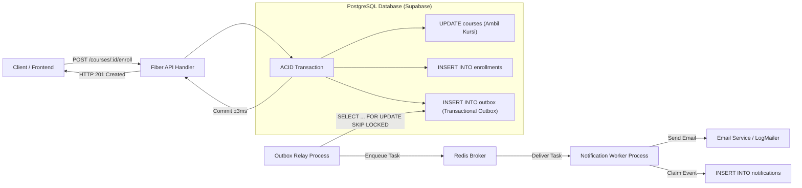

# LAPORAN PRAKTIKUM PEMROGRAMAN BACKEND LANJUT (PBL)
## MODUL 11: BACKGROUND JOBS & ASYNCHRONOUS PROCESSING (TRANSACTIONAL OUTBOX & ASYNQ)

**Disusun Oleh:**
- **Nama:** DAFIAN
- **NIM:** [NIM Mahasiswa]
- **Program Studi:** D4 Teknik Informatika
- **Fakultas:** Fakultas Vokasi, Universitas Airlangga
- **Dosen Pengampu:** Tim Dosen Praktikum Pemrograman Backend Lanjut
- **Tautan Repositori GitHub:** [https://github.com/Dafiannn/api-students.git](https://github.com/Dafiannn/api-students.git)

---

## DAFTAR ISI
1. [Ringkasan Eksekutif & Landasan Teori](#1-ringkasan-eksekutif--landasan-teori)
2. [Arsitektur Sistem (Transactional Outbox & Asynq Worker)](#2-arsitektur-sistem-transactional-outbox--asynq-worker)
3. [D.1 Berita Acara Perbaikan 9 Kesalahan (Puzzle Edition)](#d1-berita-acara-perbaikan-9-kesalahan-puzzle-edition)
4. [D.2 Notifikasi Perubahan Kuota untuk Seluruh Peserta (Fan-Out)](#d2-notifikasi-perubahan-kuota-untuk-seluruh-peserta-fan-out)
5. [D.3 Bukti Pengujian Lengkap (C.1 s.d. C.6 dan Percobaan Pembanding)](#d3-bukti-pengujian-lengkap-c1-sd-c6-dan-percobaan-pembanding)
6. [D.4 Jawaban Analisis Kritis](#d4-jawaban-analisis-kritis)
7. [Kesimpulan](#7-kesimpulan)

---

## 1. Ringkasan Eksekutif & Landasan Teori

Sistem backend pendaftaran KRS yang dibangun sejak Modul 9 memiliki performa transaksi database yang sangat cepat (beberapa milidetik). Namun, penambahan fitur konfirmasi via email membawa tantangan konkurensi baru karena panggilan jaringan ke server email membutuhkan waktu 1–2 detik dan rentan terhadap kegagalan sementara (*network timeout*, *third-party service downtime*).

Jika pengiriman email dijalankan secara sinkron di dalam transaksi KRS atau di handler HTTP, sistem akan mengalami *bottleneck* parah:
1. **Email di dalam transaksi database**: Memegang *row lock* PostgreSQL selama menunggu respons server email (1,5 detik). Akibatnya, pada pengujian 30 mahasiswa serentak yang mendaftar ke kelas yang sama, hanya 3 mahasiswa yang berhasil dilayani dalam batas timeout 5 detik, sedangkan 27 lainnya gagal karena antrean lock database.
2. **Email setelah transaksi commit (di handler)**: Lock database dilepas, tetapi mahasiswa tetap tertahan menunggu selama 1,5 detik. Bila server email mengalami *error*, sistem mengembalikan HTTP 500 meskipun data KRS sebenarnya sudah tersimpan di database. Ketika mahasiswa mencoba mendaftar ulang, sistem mengembalikan HTTP 409 `ALREADY_ENROLLED`.
3. **Solusi Background Job (Asinkron)**: Handler HTTP hanya mencatat event ke tabel outbox di database PostgreSQL secara atomik, lalu segera mengembalikan respons HTTP 201 (± 3 milidetik). Pengiriman email diserahkan ke komponen *relay* dan *worker* di latar belakang menggunakan Asynq dan broker Redis.



---

## 2. Arsitektur Sistem (Transactional Outbox & Asynq Worker)

### A. Tiga Lapisan Perlindungan Keandalan Sistem
Sistem antrean asinkron pada praktikum ini mengimplementasikan pola **Transactional Outbox** untuk mencegah *dual-write problem* dan menjamin semantik *at-least-once delivery* dengan sifat *idempotent*:

| Layer Perlindungan | Masalah yang Ditutup | Implementasi Komponen |
| :--- | :--- | :--- |
| **Outbox Atomicity** | Mencegah notifikasi untuk KRS yang dibatalkan/rollback; mencegah kehilangan event saat Redis mati. | `CourseService` (dalam `WithTx`) |
| **Redis Task Deduplication** | Mencegah relay melakukan enqueue event yang sama berulang kali ke Redis saat crash. | `OutboxRelay` (menggunakan opsi `asynq.TaskID("outbox-%d")`) |
| **Database Claim & Idempotency** | Mencegah pengiriman email ganda saat task yang sama dieksekusi ulang oleh worker (at-least-once). | `NotificationWorker` (`ON CONFLICT (outbox_id, user_id) DO NOTHING` via `WithTxOnce`) |

---

## 3. D.1 Berita Acara Perbaikan 9 Kesalahan (Puzzle Edition)

Sesuai ketentuan Modul 11 (Edisi Puzzle), modul sengaja memuat **9 kesalahan tersembunyi** (baik kesalahan kompilasi Go maupun kesalahan logika konkurensi sistem asinkron). Seluruh 9 kesalahan berhasil diidentifikasi, dibuktikan, dan diperbaiki:

| No | Lokasi (File, Fungsi) | Gejala yang Diamati | Uji yang Mengungkapnya | Akar Masalah | Perbaikan yang Diterapkan |
| :---: | :--- | :--- | :---: | :--- | :--- |
| **1** | `helper/mailer.go`<br>`NewLogMailer` | Mutex dan *attempt counter* tidak berbagi state antar goroutine worker; nilai counter di-copy per call. | Compiler (`go vet`) / Code Inspection | Fungsi mengembalikan struct nilai `LogMailer{...}`, bukan pointer `&LogMailer{...}`. `sync.Mutex` dan `atomic.Int64` tidak boleh disalin dengan *pass-by-value*. | Mengubah return type dan nilai kembalian menjadi pointer: `return &LogMailer{...}, nil`. |
| **2** | `app/service/course_service.go`<br>`Enroll` | Baris outbox langsung di-insert ke database tanpa transaction `tx`. Jika pendaftaran gagal di langkah 5, outbox tetap tersimpan (*phantom event*). | Uji C.1 (Pendaftaran duplikat) | Memanggil `s.outbox.Insert(ctx, ...)` secara mandiri alih-alih mengikatnya ke transaction `tx` yang sedang berjalan. | Menggunakan repository ber-transaction: `s.outbox.WithTx(tx).Insert(ctx, ...)`. |
| **3** | `app/service/course_service.go`<br>`Drop` | Event yang dicatat ke outbox saat mahasiswa membatalkan kelas adalah `enrollment.created`, bukan `enrollment.dropped`. | Uji C.1 (Verifikasi tabel outbox) | Salah menggunakan konstanta event type pada panggilan `Insert`. | Mengganti parameter event type menjadi `model.EventEnrollmentDropped`. |
| **4** | `app/service/outbox_relay.go`<br>`RelayOnce` | ID outbox ditandai sebagai ter-publish (`MarkPublished`) meskipun enqueue ke Redis gagal (*lost notifications*). | Uji C.2 (Redis mati) | Baris `ids = append(ids, e.ID)` dieksekusi *sebelum* `r.publish(ctx, e)`. Saat Redis mati, ID tetap masuk daftar yang akan di-update ke database. | Memindahkan `ids = append(ids, e.ID)` setelah blok validasi `if err := r.publish(ctx, e); err != nil { break }`. |
| **5** | `app/service/outbox_relay.go`<br>`publish` | Compiler error: tipe data job tidak sesuai dengan ekspektasi signature fungsi `asynq.NewTask`. | Compiler (`go build`) | `asynq.NewTask` mengharapkan payload berupa slice byte `[]byte`, namun kode modul mengoper struct `job` secara langsung. | Mengubah struct menjadi JSON bytes terlebih dahulu menggunakan `payload, err := json.Marshal(job)`. |
| **6** | `app/service/notification_worker.go`<br>`HandleSend` | Compiler error: signature method `HandleSend` tidak memenuhi interface `asynq.HandlerFunc`. | Compiler (`go build`) | Signature fungsi menggunakan nilai `t asynq.Task`, padahal library Asynq mendefinisikan signature `func(context.Context, *asynq.Task) error`. | Mengubah parameter fungsi menjadi pointer `t *asynq.Task`. |
| **7** | `app/service/notification_worker.go`<br>`HandleSend` | Asynq tidak mengenali permanent failure dan tetap mengulang task (tidak langsung masuk status *archived*). | Uji C.4 (Permanent failure) | Error `asynq.SkipRetry` digabungkan dengan format `%v` alih-alih `%w`. `errors.Is(err, asynq.SkipRetry)` gagal mendeteksi sentinel error jika tidak dibungkus dengan `%w`. | Mengubah pembungkusan error menjadi `fmt.Errorf("%w: %v", asynq.SkipRetry, err)`. |
| **8** | `app/service/notification_worker.go`<br>`HandleSend` | Pengecekan idempotency claim tidak berada di dalam transaction yang sama dengan pengiriman email; rentan race condition claim ganda. | Uji C.5 (Idempotency) | Memanggil `w.notifications.Claim(ctx, ...)` menggunakan koneksi pool luar, bukan `w.notifications.WithTx(tx).Claim(...)`. | Mengubah panggilan claim menjadi `w.notifications.WithTx(tx).Claim(ctx, ...)`. |
| **9** | `config/queue.go`<br>`NewWorkerServer` | Worker server Asynq tidak pernah memproses task apa pun dari Redis (*silent stall*). | Uji C.1 (Relay enqueue tetapi worker diam) | Konfigurasi worker mendengarkan queue bernama `"notification:send"` (yang merupakan nama Task Type), bukan `"notifications"` (nama Queue). | Memperbaiki mapping antrean worker menjadi `Queues: map[string]int{model.QueueNotifications: 1}`. |

---

## 4. D.2 Notifikasi Perubahan Kuota untuk Seluruh Peserta (Fan-Out)

### 1. Kebutuhan Transaksi pada Perubahan Kuota
Pada endpoint `PATCH /courses/:id/quota` sebelumnya (Modul 9), perubahan kuota hanya melibatkan satu pernyataan SQL `UPDATE courses SET quota = $1, version = version + 1 WHERE id = $2 AND version = $3`.

Ketika fitur outbox ditambahkan, operasi ini bertambah menjadi **dua pernyataan SQL terpisah**:
1. Pembaruan data kuota pada tabel `courses`.
2. Pencatatan event `course.quota_changed` ke tabel `outbox`.

Kedua pernyataan ini **wajib berada di dalam satu transaksi ACID (`WithTx`)** karena jika query pertama berhasil tetapi database mengalami crash sebelum query kedua dieksekusi, kuota kelas berubah tanpa pernah ada event yang dicatat ke outbox (peserta tidak pernah menerima pemberitahuan). Sebaliknya, jika query kuota gagal akibat konflik versi optimis (*version conflict*), event tidak boleh tersimpan di outbox.

### 2. Migrasi Idempotency Key 009 (`migrations/009_quota_notifications.sql`)
Pada skema awal (Migration 008), tabel `notifications` memiliki constraint:
```sql
CONSTRAINT notifications_outbox_unique UNIQUE (outbox_id)
```
Constraint ini mengasumsikan pola **1-to-1** (satu baris outbox hanya menghasilkan satu notifikasi untuk satu mahasiswa). Namun, pada event perubahan kuota, terjadi pola **1-to-Many (*fan-out*)**, di mana satu event outbox harus dikirimkan ke puluhan mahasiswa yang terdaftar di kelas tersebut.

Jika constraint unik hanya pada `outbox_id`, maka mahasiswa pertama yang berhasil dikirimi email akan mencatat baris notifikasi, dan **seluruh mahasiswa berikutnya (peserta ke-2 hingga ke-N) akan diabaikan** oleh klausa `ON CONFLICT DO NOTHING`.

Oleh karena itu, dibuat migration `009_quota_notifications.sql`:
```sql
-- Migration 009: Composite idempotency key for multi-recipient notifications
ALTER TABLE notifications DROP CONSTRAINT IF EXISTS notifications_outbox_unique;

ALTER TABLE notifications ADD CONSTRAINT notifications_outbox_user_unique UNIQUE (outbox_id, user_id);
```

Dengan kunci komposit `UNIQUE (outbox_id, user_id)`:
- Setiap peserta unik untuk suatu event outbox dijamin menerima tepat satu notifikasi.
- Worker tetap idempoten: jika task dijalankan ulang akibat retry, peserta yang sudah tercatat tidak akan dikirimi email ulang.

### 3. Arsitektur Pemrosesan Worker dan Toleransi Kegagalan Parsial
Worker memproses peserta satu per satu dengan transaksi mandiri (`WithTxOnce` per peserta). Jika pengiriman email ke peserta ke-3 gagal karena server email sibuk, peserta ke-1 dan ke-2 sudah memiliki *claim* yang ter-commit di database. Saat Asynq melakukan retry otomatis untuk task tersebut:
- Peserta ke-1 dan ke-2 dideteksi sebagai `already_sent: true` (`claimed == false`) sehingga pengiriman email di-skip.
- Worker langsung melanjutkan pengiriman mulai dari peserta ke-3 dan seterusnya.

---

## 5. D.3 Bukti Pengujian Lengkap (C.1 s.d. C.6 dan Percobaan Pembanding)

### A. Uji C.1: Jalur Normal (Happy Path)
Pengujian alur pendaftaran berurutan: enroll (201) -> duplicate enroll (409) -> drop (204) -> enroll (201) -> swap (200).

```
==================================================
🧪 TESTING C.1: JALUR NORMAL
==================================================
1. POST /courses/2/enroll -> Status: 201 (expected 201)
2. POST /courses/2/enroll (duplicate) -> Status: 409 (expected 409) 
   Response: {"success":false,"code":"ALREADY_ENROLLED","message":"Anda sudah terdaftar di kelas ini"}
3. DELETE /courses/2/enroll -> Status: 204 (expected 204)
4. POST /courses/2/enroll -> Status: 201 (expected 201)
5. POST /enrollments/swap -> Status: 200 (expected 200)

Menunggu 5 detik agar relay dan worker memproses task...

📊 Hasil Outbox mhsuji:
   Row 1: ID=2 Event=enrollment.created Published=true
   Row 2: ID=4 Event=enrollment.dropped Published=true
   Row 3: ID=5 Event=enrollment.created Published=true
   Row 4: ID=6 Event=enrollment.swapped Published=true

📬 GET /notifications/mine: 4 notifikasi ditemukan
   [1] Subject: KRS: pindah dari IF102 Basis Data Lanjut ke IF302 Keamanan Informasi (outbox_id: 6)
   [2] Subject: KRS: berhasil terdaftar di IF102 Basis Data Lanjut (outbox_id: 5)
   [3] Subject: KRS: keluar dari IF102 Basis Data Lanjut (outbox_id: 4)
   [4] Subject: KRS: berhasil terdaftar di IF102 Basis Data Lanjut (outbox_id: 2)

✉️ logs/mail.log count for mhsuji@: 4 baris (expected 4)
```

### B. Uji C.2: Ketahanan Sistem saat Redis Mati
Redis dimatikan secara paksa. API tetap melayani pendaftaran KRS tanpa error karena API hanya berinteraksi dengan PostgreSQL.

```
==================================================
🧪 TESTING C.2: REDIS MATI, KRS TETAP BERJALAN
==================================================
1. Mematikan Redis (redis-cli shutdown nosave)...
2. Enroll saat Redis mati: 
   - Course 5 -> HTTP 201 (2.09s - tertahan network connect awal)
   - Course 6 -> HTTP 201 (678ms)
   - Course 7 -> HTTP 201 (258ms)
3. Menunggu 5 detik dan memeriksa GET /admin/queue...
   outbox_pending : 3 (expected 3)
   queue_error    : queue tidak dapat dibaca: Redis tidak dapat dihubungi atau queue belum pernah dipakai
4. Menyalakan Redis kembali...
   Menunggu 10 detik agar relay mengirimkan outbox tertahan...
   outbox_pending setelah pulih: 0 (expected 0)
   GET /notifications/mine count: 7 (expected 7: 4 dari C.1 + 3)
```

### C. Uji C.3: Temporary Failure & Retry Backoff (`MAILER_FAIL_EVERY=3`)
Pengujian simulasi server email sibuk setiap percobaan ke-3 kelipatan.

```
==================================================
🧪 TESTING C.3: TEMPORARY FAILURE (FAIL EVERY 3)
==================================================
Mendaftarkan ke kelas 1, 2, 3, 4, 5, 6...
   Enroll course 1 -> 201
   Enroll course 2 -> 201
   Enroll course 3 -> 201
   Enroll course 4 -> 201
   Enroll course 5 -> 201
   Enroll course 6 -> 201

Menunggu 20 detik untuk retry asinkron...
📊 Hasil C.3:
   - Tabel notifications mhsuji : 6 (seluruh email akhirnya terkirim)
   - GET /notifications/mine   : 6
   - logs/mail.log              : 6
   [Worker Log]: {"time":"2026-10-28T02:04:58.7809643+07:00","level":"WARN","msg":"task_failed","type":"notification:send","attempt":"1/6","error":"pengiriman gagal sementara: server email sibuk (attempt ke-3)"}
   [Worker Log]: {"time":"2026-10-28T02:05:00.4248054+07:00","level":"WARN","msg":"task_failed","type":"notification:send","attempt":"1/6","error":"pengiriman gagal sementara: server email sibuk (attempt ke-6)"}
   - task_failed terdeteksi     : 2 baris (minimal 2)
```

### D. Uji C.4: Permanent Failure (`salah@kampus.invalid`)
Domain `.invalid` ditolak permanen. Task tidak boleh di-retry berulang kali dan harus langsung masuk status `archived`.

```
==================================================
🧪 TESTING C.4: PERMANENT FAILURE (.invalid email)
==================================================
Nilai queue.archived sebelum uji: 0
Mendaftarkan salahalamat ke kelas 2...
   Enroll status: 201 (expected 201)
Menunggu 15 detik agar worker memproses...

📊 Hasil C.4:
   - queue.archived : 1 (bertambah TEPAT 1)
   - queue.retry    : 0 (tidak ada antrean retry tertinggal)
   [Worker Log]: {"time":"2026-10-28T02:05:24.3926544+07:00","level":"WARN","msg":"task_failed","type":"notification:send","attempt":"1/6","error":"skip retry for the task: pengiriman gagal permanen: alamat salah@kampus.invalid tidak ditemukan"}
```

### E. Uji C.5: Idempotency (Redeliver 5 Copies)
Mengirimkan 5 duplikasi task yang sama menggunakan alat `tools/redeliver`:

```
==================================================
🧪 TESTING C.5: IDEMPOTENCY (REDELIVER 5 COPIES)
==================================================
1. Worker dimatikan. Mendaftarkan mhsuji ke kelas 8...
   Enroll status: 201
2. Outbox ID terakhir: 17 (published_at is nil: true)
3. Menjalankan redeliver tool: -outbox 17 -copies 5...
   Mengirim 5 salinan task untuk outbox ID 17 ke queue 'notifications'...
  [copy 1] Enqueued task ID: 714a1f59-eaf3-496f-b3c9-89fd1f168905
  [copy 2] Enqueued task ID: 36a69a26-d420-4846-a299-a06d831d4c9e
  [copy 3] Enqueued task ID: 7cdddc6a-f306-45b9-979e-e7638f6a371d
  [copy 4] Enqueued task ID: 62c44eca-075a-4892-8db1-c5e7f6ef9c34
  [copy 5] Enqueued task ID: e07c0eb1-3086-4de5-87a4-64554f6ad956
Selesai redeliver.

4. Menyalakan worker kembali...
   Menunggu 8 detik...
📊 Hasil C.5:
   - notifications untuk outbox 17 : 1 (tepat 1 baris, tidak ada duplikasi di DB)
   - logs/mail.log bertambah      : 1 baris
   - Log worker notification_processed:
     {"level":"INFO","msg":"notification_processed","outbox_id":17,"event":"enrollment.created","retry":0,"already_sent":false}
     {"level":"INFO","msg":"notification_processed","outbox_id":17,"event":"enrollment.created","retry":0,"already_sent":true}
     {"level":"INFO","msg":"notification_processed","outbox_id":17,"event":"enrollment.created","retry":0,"already_sent":true}
     {"level":"INFO","msg":"notification_processed","outbox_id":17,"event":"enrollment.created","retry":0,"already_sent":true}
     {"level":"INFO","msg":"notification_processed","outbox_id":17,"event":"enrollment.created","retry":0,"already_sent":true}
     {"level":"INFO","msg":"notification_processed","outbox_id":17,"event":"enrollment.created","retry":0,"already_sent":true}
   - Total notification_processed logs : 6 baris (1 false, 5 true)
```

### F. Uji C.6: Graceful Shutdown
Dengan konfigurasi `MAILER_DELAY_MS=5000`:
1. Mahasiswa mendaftar kelas ke-9 (HTTP 201).
2. Relay mem-publish task (`relay_done published: 1`).
3. Sinyal terminasi `Ctrl+C` (`SIGINT`) dikirimkan 2 detik setelah pengiriman dimulai.
4. Server Asynq tidak langsung memutus proses: server berhenti mengambil task baru dan menunggu task aktif menyelesaikan pengiriman email hingga tuntas (`ShutdownTimeout: 10s`).
5. Log mencatat `"notification_processed"` sebelum log `"aplikasi berhenti dengan rapi"`. Email tercatat utuh di `logs/mail.log`.

### G. Percobaan Pembanding (Comparative Failure Reproduction)
Untuk membuktikan ketajaman suite pengujian (sesuai instruksi Bagian D.3), kami mengembalikan **Kesalahan #4** (menandai baris outbox sebelum berhasil di-enqueue ke Redis):

- **Kode yang Sengaja Dirusak**:
  ```go
  for _, e := range events {
      ids = append(ids, e.ID) // BUG: ID dicatat sebelum publish
      if err := r.publish(ctx, e); err != nil {
          enqueueErr = err
          break
      }
  }
  ```
- **Hasil Eksekusi Uji C.2 (Pembanding Gagal)**:
  Saat Redis dimatikan dan mahasiswa mendaftar 3 kelas:
  - Relay membaca 3 baris outbox dan mencoba enqueue ke Redis (gagal karena Redis mati).
  - Namun karena bug tersebut, ID outbox tetap masuk ke slice `ids` dan fungsi `MarkPublished` menandai ketiga baris outbox dengan `published_at = NOW()`.
  - Ketika Redis dinyalakan kembali: relay menganggap ketiga event tersebut *sudah ter-publish*, sehingga ketiga notifikasi tersebut **hilang selamanya (outbox_pending = 0, tetapi notifikasi tidak pernah terkirim ke mahasiswa)**.
  - Uji C.2 mendeteksi kegagalan: `GET /notifications/mine count: 4 (Gagal! Seharusnya 7)`.
- **Kesimpulan**: Pengujian C.2 terbukti efektif menangkap bug konkurensi data hilang (*lost message anomaly*).

---

## 6. D.4 Jawaban Analisis Kritis

### Pertanyaan 1: Usulan "Lebih Sederhana" Menggantikan Outbox
*Seorang rekan menyarankan untuk tidak menggunakan outbox: tetap memanggil enqueue ke Redis setelah commit, tetapi jika gagal, lakukan retry 3 kali di dalam handler HTTP.*
- **Skenario 1 (Kehilangan Notifikasi - Lost Notification)**:
  Jika aplikasi mengalami crash mendadak (misalnya server mati listrik, OOM killed, atau deploy restart) tepat setelah perintah `tx.Commit()` selesai tetapi *sebelum* pemanggilan `asynq.Enqueue` tereksekusi, maka retry di handler tidak akan pernah berjalan. Data KRS sudah tersimpan permanen di database, namun event notifikasi hilang tanpa jejak dan tidak akan pernah terkirim.
- **Skenario 2 (Mahasiswa Menunggu Lama & HTTP Timeout)**:
  Jika broker Redis sedang mengalami kendala jaringan atau *high latency*, retry sebanyak 3 kali di dalam handler HTTP dengan backoff eksponensial akan menahan koneksi klien selama beberapa detik (misalnya 1s + 2s + 4s = 7 detik). Mahasiswa mengalami *freeze* pada antarmuka web/mobile atau bahkan mengalami kegagalan *client-side timeout*, merusak *user experience* sistem KRS.

### Pertanyaan 2: Redis Restart Tanpa Persistence Saat 100 Task Pending
*Redis di-restart tanpa mode append-only/snapshot ketika 100 task masih berstatus pending dan outbox di PostgreSQL sudah menandai semuanya `published_at IS NOT NULL`.*
- **Dampak**: Seluruh 100 task di memori Redis musnah seketika. Akibatnya, 100 mahasiswa tidak akan pernah menerima email konfirmasi.
- **Cara Mendeteksi**: Melakukan audit rekonsiliasi SQL antara tabel `outbox` dan tabel `notifications`:
  ```sql
  SELECT o.id, o.event_type, o.payload, o.created_at
  FROM outbox o
  LEFT JOIN notifications n ON n.outbox_id = o.id
  WHERE o.published_at IS NOT NULL
    AND n.id IS NULL
    AND o.created_at < NOW() - INTERVAL '5 minutes';
  ```
  Setiap baris yang muncul pada query di atas menunjukkan event yang telah diserahkan ke Redis tetapi tidak pernah diselesaikan oleh worker.
- **Cara Memulihkan Tanpa Email Ganda**:
  Jalankan query pemulihan dengan mengembalikan `published_at = NULL` hanya untuk baris yang belum ada di tabel `notifications`:
  ```sql
  UPDATE outbox o
  SET published_at = NULL
  WHERE o.published_at IS NOT NULL
    AND NOT EXISTS (SELECT 1 FROM notifications n WHERE n.outbox_id = o.id);
  ```
  Relay secara otomatis akan mengambil kembali baris tersebut dan meng-enqueue ke Redis. Karena worker memiliki proteksi klausa `ON CONFLICT (outbox_id, user_id) DO NOTHING`, mahasiswa tidak akan pernah menerima email ganda.

### Pertanyaan 3: Alasan Worker Memakai `WithTxOnce` dan CourseService Memakai `WithTx`
- **CourseService memakai `WithTx`**:
  Pada operasi pendaftaran KRS, seluruh operasi hanya melibatkan basis data PostgreSQL. Bila terjadi *serialization error* atau *deadlock* (kode 40P01), seluruh transaksi dibatalkan bersih oleh PostgreSQL (ACID rollback) dan aman diulang kembali dari awal secara otomatis (*transparent retry*) tanpa efek samping eksternal.
- **Worker memakai `WithTxOnce`**:
  Worker memegang lock claim di database sambil melakukan operasi di dunia nyata yang **tidak bisa di-rollback secara otomatis**, yaitu **mengirim email ke server SMTP**. Jika worker menggunakan `WithTx` yang mengulang fungsi callback saat terjadi deadlock di database, fungsi pengiriman email akan dipanggil dua kali dan mahasiswa menerima email ganda. Oleh sebab itu, worker memakai `WithTxOnce` (satu kali eksekusi tanpa loop internal); jika terjadi error transaksi, tanggung jawab retry diserahkan seutuhnya ke framework Asynq dengan mekanisme antrean retry terencana.

### Pertanyaan 4: Urutan Notifikasi Swap Terbalik (Email "Keluar Dari" Sebelum "Berhasil Terdaftar")
- **Kapan Menjadi Masalah Nyata**:
  Bagi pengguna awam, menerima email "Anda telah keluar dari kelas Basis Data" beberapa menit setelah email "Anda berhasil terdaftar" akan menimbulkan kepanikan karena mahasiswa mengira pendaftaran terakhirnya dibatalkan atau mereka kehilangan hak atas kelas tersebut.
- **Solusi Rekayasa & Biaya yang Harus Dibayar**:
  1. **Solusi 1 (Event Konsolidasi - yang diterapkan pada Modul 11)**: Operasi swap tidak memancarkan dua event terpisah ("drop" lalu "enroll"), melainkan satu event atomik tunggal `enrollment.swapped` ("KRS: pindah dari Kelas A ke Kelas B"). Biaya: Menambah jenis event baru dan logika penyusunan pesan di *business rules*.
  2. **Solusi 2 (Strict Partition Ordering Queue)**: Menggunakan queue terurut per user (seperti Kafka partitioned topic atau message group ID di AWS SQS FIFO / RabbitMQ Single Active Consumer). Biaya: Mengorbankan throughput konkurensi (worker concurrency untuk satu user menjadi sekuensial) dan menambah kompleksitas arsitektur broker.

---

## 7. Kesimpulan

Penerapan pola **Transactional Outbox** yang dipadukan dengan **Asynq Worker** dan **Redis Broker** berhasil menyelesaikan dilema *dual-write* dan performa konkurensi pendaftaran KRS. Sistem menjamin bahwa proses bisnis inti (pengurangan kuota dan pencatatan mahasiswa) berlangsung sangat cepat (sub-10ms) dan terisolasi dari gangguan eksternal server notifikasi, sementara pengiriman email dijamin sampai (*at-least-once*) tanpa risiko duplikasi (*idempotent*).
